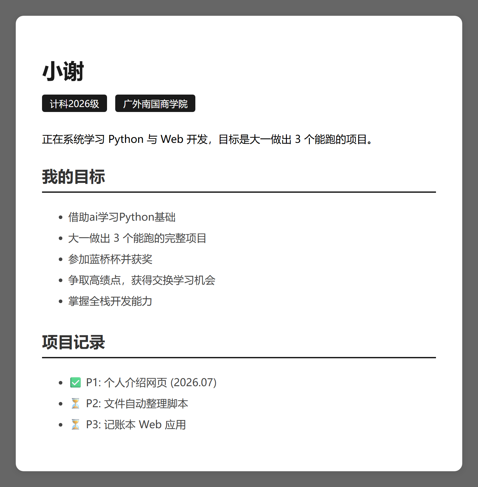

<div align="center">

# 我的第一个网页 · may-first-website

**一个手写的 HTML/CSS 个人主页 —— 我写的第一段前端代码。**

<a href="https://anhaoxie.github.io/may-first-website/"></a>
<a href="LICENSE"></a>




</div>

---

## 这是什么

2026 年 7 月底，我开始学 Web 开发。这是第一件做出来的东西：**一个 HTML 文件，CSS 直接写在
`<style>` 标签里，没有框架、没有构建步骤、没有依赖。**

页面上写着当时的目标——"大一做出 3 个能跑的完整项目"。这个仓库就是第一个。

## 在线预览

<https://anhaoxie.github.io/may-first-website/>

## 页面里有什么

| 区块 | 内容 |
| --- | --- |
| 标题区 | 姓名 + 两个标签（年级 / 学校），用纯 CSS 做的圆角标签 |
| 我的目标 | 学 Python、做完 3 个项目、参加蓝桥杯、争取交换、掌握全栈 |
| 项目记录 | 用 ✅ / ⏳ 标记三个计划（P1 网页 / P2 整理脚本 / P3 记账本）的进度 |

样式上做了卡片式布局：深灰底 + 白色圆角卡片 + 阴影，`max-width: 600px` 居中。

## 目录结构

```
index.html                    整个主页，HTML 和 CSS 都在这一个文件里
docs/
  screenshot.png              本文件顶部用的截图
tools/
  clean_downloads.py          P2：按文件类型自动整理下载文件夹的小脚本
LICENSE
```

### 关于 `tools/clean_downloads.py`

这是页面里写的 **P2（文件自动整理脚本）**，最早和主页混在同一个目录里，现在移到 `tools/` 下。
它按扩展名把文件分到「图片 / 文档 / 视频 / 音乐 / 压缩包 / 程序」六个子文件夹：

```bash
python tools/clean_downloads.py              # 整理系统的「下载」文件夹
python tools/clean_downloads.py D:\some\dir  # 或指定任意文件夹
```

只移动、不删除；遇到重名会自动加 `-1`、`-2` 后缀，不会覆盖已有文件。

## 为什么留着它

这个页面本身很朴素，但它证明了最基础的那条链路是通的：**写一个 `.html` → 用浏览器打开 → 它真的显示出来了。**
后面所有的项目——Next.js、TypeScript、Vercel——都是从这一步开始的。

## License

[MIT](LICENSE) © anhaoXie
